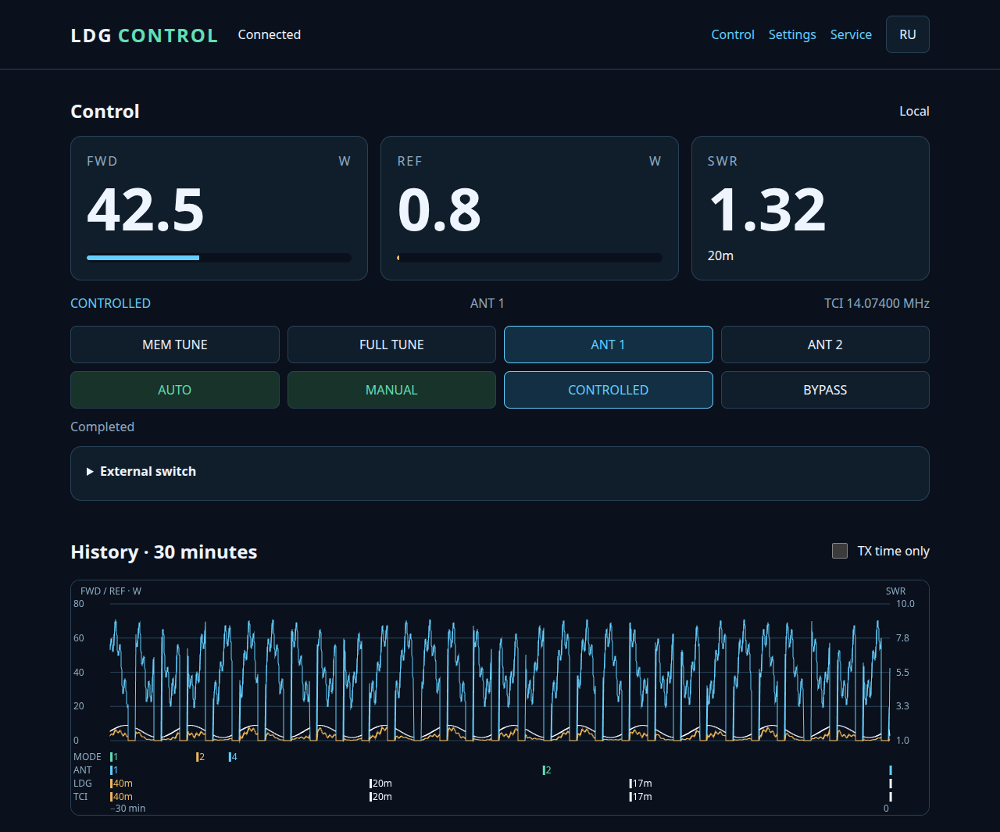
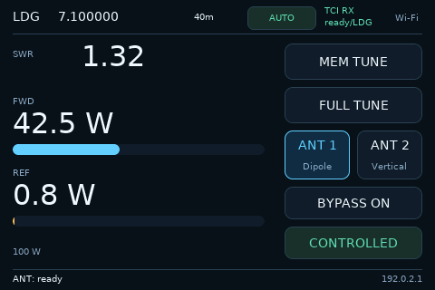
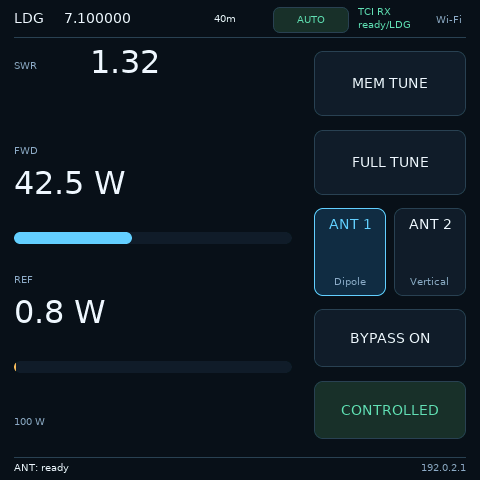
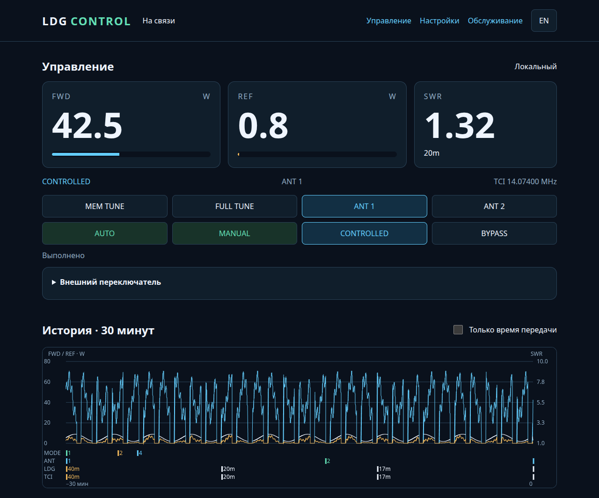

# LDGControl-IDF

[English](#english) | [Русский](#russian)

<a id="english"></a>

## English

LDG AT-1000ProII / AT-600ProII controller built with ESP-IDF 5.5.5 and C++20.
Use a local UART tuner or a separate network control panel. Displays use LVGL 9.6.0;
the web interface is embedded in the application and updates together with it.

- FWD, REF and SWR readings; 160–6 m bands; MEM/FULL TUNE; AUTO/MANUAL/BYPASS/CONTROLLED; ANT1/ANT2.
- CONTROLLED skips MEM TUNE when the initial SWR is good and avoids endless retries under a constant mismatch.
- Automatic antenna selection from LDG or the future TCI transmit frequency, including split/XIT, manual priority and RF checks.
- HTTP API v2, MQTT API 2, Logger Bridge and Home Assistant discovery.
- English web interface by default, with a Russian language switch; charts at the bottom of the main page; 30 minutes of browser history and a transmit-time mode.
- File and GitHub Releases OTA, signature and SHA-256 verification, two application slots and rollback.
- External antenna-switch routes and a 16-port simulator. Hardware-specific drivers are added separately.

Every integration is optional. Settings remain accessible without a tuner,
Internet access, an MQTT broker or TCI. There is no mandatory setup wizard.

### Interface

English opens by default, including in a Russian-language browser. Click **RU**
in the top bar to switch to Russian; **EN** switches back. The choice is saved
in that browser. Changing language keeps open forms and entered values.



Web interface with example telemetry. See the [interface guide](docs/interface.md)
for mobile controls, display settings and error messages.

**Sunton device display — 480×320**



**Guition device display — 480×480**



LVGL screen captures with example telemetry. The device display uses English;
the web language switch applies to the browser. See [device display](docs/interface.md#device-display)
for high-SWR readings and the firmware update screen.

### Boards

| Profile | Board | Display | Flash |
|---|---|---|---|
| `headless` | ESP32 without a display | — | 4 MB |
| `sunton` | ESP32-3248S035C | 480×320, landscape 0°/180° | 4 MB |
| `guition` | ESP32-4848S040, ESP32-S3 | 480×480 | 16 MB, octal PSRAM |

Check the board marking and memory capacity before installation. Wiring:
[boards and UART](docs/hardware.md).

### Build

Install Python 3.12+, Git and the ESP-IDF system build dependencies. From the
project directory:

```sh
python tools/bootstrap.py --board sunton
```

The command downloads ESP-IDF **5.5.5**, its tools and dependencies into `.tools/`,
prepares Node/npm if needed, and builds the selected profile. It does not change
global Node packages or the system PATH. On Windows, use a short checkout path
such as `C:\dev\LDGControl-IDF`; the SDK can be placed separately:

```powershell
python tools/bootstrap.py --board sunton --sdk-dir C:\idf-5.5.5
```

With an existing ESP-IDF 5.5.5 installation and its environment activated:

```sh
python tools/build.py --board sunton
```

Other profiles are `headless` and `guition`. Output:
`build-<profile>/ldgcontrol.bin`. Building does not write to a device.
The first migration from Remote-LDGControl uses USB and the application,
bootloader, partition table and initial OTA data from the same build. In the
activated IDF environment:

```sh
idf.py -B build-sunton -p PORT flash monitor
```

Replace `PORT` with the serial port of your device. Avoid `erase-flash` when
preserving settings. Subsequent updates use OTA.

### Getting started

1. Connect to the `LDGControl-IDF` access point with password `ldgcontrol`.
2. Open `http://192.168.4.1/`. Without migrated credentials, sign in as
   `admin` / `change_me_please`. Change the password under **Settings → Device and access**.
3. If needed, configure your Wi-Fi network and use **Service → Restart device**.
   The access point remains available for recovery.
4. Configure only the sections you need. For a remote panel, enable **Remote tuner**
   and enter the address of a controller with the same API version. Both devices
   must use matching Basic Auth credentials. Remote-panel chains are not supported.

Pressing BYPASS again returns to AUTO. ANT1/ANT2 select a named port rather than
blindly toggling it. Unknown readings appear as dashes. Software cancellation
cannot stop a physical tuning operation that has already started.

If saving conflicts with another window, your input stays in the form. Load the
current values to compare and explicitly save your version. An action error
appears beside the action and in a visible notification. The notification expires
after eight seconds, pausing while hovered or focused.

### Updates

In **Service**, check GitHub or select a `.bin` file and its matching
`<profile>.manifest.json`. The browser checks for stable releases once per day;
installation always requires a user action. File uploads work without Internet
access. A failed GitHub check does not interrupt control.

An update waits for the current hardware operation and confirmed transmission to
finish. MQTT, TCI and remote exchange are then paused. The display shows the stage,
percentage and byte count; progress redraws at most once per second. Modules
resume after failure or cancellation. Abandoned transfers time out.

Only packages for the selected board, signed with the key matching
`release-public.pem`, are accepted. Prepare trusted-key changes in firmware in
advance; the private key is not versioned in this repository. No eFuses are changed.

### Integrations and diagnostics

[HTTP API v2 and MQTT](docs/api.md) describes commands, results and conflicts.
Diagnostics report free internal memory, the largest block, minimum free memory,
UART counters, MQTT state, reset reason and pending settings saves.
If charts fail to load, use their local retry button; controls remain available.
Power scales and Sunton automatic brightness are configured independently.

Remote-LDGControl settings are imported from the previous NVS namespace on the
first boot. Old records are preserved. Legacy HTTP endpoints are not supported;
update the controller and its remote panel together.

### License and authors

[GPL-3.0](LICENSE). Based on Remote-LDGControl `0d242cc` behavior:
[Ben Kuhn](https://github.com/ben-kuhn/Remote-LDGControl), Dmitry E (RA3VLD)
and contributors. Protocol reverse engineering: Efpophis and contributors to
[LDGControl](https://github.com/Efpophis/LDGControl); band thresholds: Ardugnome.
Additional attribution and component licenses: [NOTICE](NOTICE).

---

<a id="russian"></a>

## Русский

Контроллер LDG AT-1000ProII / AT-600ProII на ESP-IDF 5.5.5 и C++20.
Поддерживает локальный UART-тюнер и отдельную сетевую панель управления.
Экран использует LVGL 9.6.0; веб встроен в приложение и обновляется вместе с ним.

- FWD, REF, SWR, диапазоны 160–6 м, MEM/FULL TUNE, AUTO/MANUAL/BYPASS/CONTROLLED, ANT1/ANT2.
- CONTROLLED пропускает MEM TUNE при хорошем начальном КСВ и не повторяет настройку бесконечно при постоянном рассогласовании.
- Автовыбор антенны по LDG или будущей частоте передачи TCI, включая split/XIT, ручной приоритет и проверки RF.
- HTTP API v2, MQTT API 2, Logger Bridge и Home Assistant discovery.
- Веб с английским по умолчанию и переключением на русский, графики внизу главной страницы, 30 минут истории в браузере и режим времени передачи.
- OTA из файла или GitHub Releases, проверка подписи и SHA-256, два слота приложения и rollback.
- Внешний антенный переключатель: маршруты и симулятор 16 портов. Драйвер конкретного оборудования добавляется отдельно.

Ни одна интеграция не обязательна. Настройки доступны без тюнера, Интернета,
брокера и TCI. Отсутствующие подключения не требуют проходить мастер настройки.

### Интерфейс

При первом открытии используется английский, в том числе в русскоязычном браузере.
Нажмите **RU** в верхней панели, чтобы перейти на русский; **EN** возвращает
английский. Выбор сохраняется в этом браузере. Переключение языка сохраняет
открытые формы и введённые значения.



Веб-интерфейс с примером телеметрии. Мобильный вид, настройки экрана и сообщения
об ошибках описаны в [руководстве по интерфейсу](docs/interface.ru.md).

**Дисплей Sunton — 480×320**


**Дисплей Guition — 480×480**


Снимки экранов LVGL с примером телеметрии. Дисплей устройства использует английский;
переключатель языка веб-интерфейса действует в браузере. Показания при высоком КСВ и экран
обновления показаны в разделе [дисплея устройства](docs/interface.ru.md#дисплей-устройства).

### Платы

| Профиль | Плата | Экран | Flash |
|---|---|---|---|
| `headless` | ESP32 без экрана | — | 4 МБ |
| `sunton` | ESP32-3248S035C | 480×320, горизонтально 0°/180° | 4 МБ |
| `guition` | ESP32-4848S040, ESP32-S3 | 480×480 | 16 МБ, octal PSRAM |

Сверьте маркировку и объём памяти платы перед установкой. Подключения:
[платы и UART](docs/hardware.ru.md).

### Сборка

Нужны Python 3.12+, Git и системные зависимости сборки ESP-IDF. Из каталога проекта:

```sh
python tools/bootstrap.py --board sunton
```

Команда скачивает ESP-IDF **5.5.5**, его инструменты и зависимости в `.tools/`,
готовит Node/npm при их отсутствии и собирает выбранный профиль. Глобальные
пакеты Node и системный PATH не меняются. Для Windows используйте короткий путь,
например `C:\dev\LDGControl-IDF`; SDK можно разместить отдельно:

```powershell
python tools/bootstrap.py --board sunton --sdk-dir C:\idf-5.5.5
```

Если ESP-IDF 5.5.5 уже установлен и его окружение активировано:

```sh
python tools/build.py --board sunton
```

Другие профили: `headless`, `guition`. Результат: `build-<профиль>/ldgcontrol.bin`.
Сборка сама по себе ничего не записывает в устройство. Первый переход с
Remote-LDGControl выполняется по USB: нужны приложение, загрузчик, таблица
разделов и начальные OTA-данные из одной сборки. В активированном окружении IDF:

```sh
idf.py -B build-sunton -p PORT flash monitor
```

Замените `PORT` именем своего последовательного порта. Не используйте `erase-flash`,
если нужно сохранить настройки. Для следующих обновлений используйте OTA.

### Начало работы

1. Подключитесь к точке `LDGControl-IDF`, пароль `ldgcontrol`.
2. Откройте `http://192.168.4.1/`. При отсутствии перенесённых настроек вход:
   `admin` / `change_me_please`. Измените пароль в «Настройки → Устройство и доступ».
3. При необходимости задайте домашний Wi-Fi и перезапустите устройство кнопкой
   «Обслуживание → Перезапустить». Точка доступа остаётся способом восстановления.
4. Настройте только нужные разделы. Для удалённой панели включите «Удалённый тюнер»
   и укажите адрес контроллера с этой же версией API. Данные Basic Auth на обоих
   устройствах должны совпадать. Цепочки удалённых панелей не поддерживаются.

Повторное нажатие BYPASS возвращает AUTO. ANT1/ANT2 — именованный выбор порта;
кнопка не означает безусловное переключение. Неизвестные измерения показаны
прочерками. Начатую физическую настройку нельзя остановить программной отменой.

При конфликте сохранения введённые значения остаются в форме. Откройте актуальную
версию для сравнения и явно сохраните свой вариант. Сообщение об ошибке есть у
действия и в видимой части окна; уведомление исчезает через восемь секунд.

### Обновления

В «Обслуживание» можно проверить GitHub или выбрать `.bin` и соответствующий
`<профиль>.manifest.json`. Проверка новых стабильных релизов выполняется браузером
раз в сутки и не устанавливает их автоматически. Файловая загрузка работает без
Интернета. Ошибка проверки GitHub не мешает управлению.

Обновление ожидает окончания аппаратной команды и подтверждённой передачи.
После этого MQTT, TCI и удалённый обмен приостанавливаются. Экран показывает этап,
процент и объём; прогресс обновляется не чаще раза в секунду. При ошибке или отмене
модули возобновляют работу. Незавершённая загрузка отменяется по тайм-ауту.

Принимаются только комплекты для выбранной платы, подписанные ключом,
соответствующим `release-public.pem`. Замену доверенного ключа готовят заранее
в прошивке; приватный ключ в репозитории отсутствует. eFuse не изменяются.

### Интеграции и диагностика

[HTTP API v2 и MQTT](docs/api.ru.md) описывает команды, результаты и конфликты.
Раздел диагностики показывает внутреннюю свободную память, крупнейший блок,
минимум памяти, счётчики UART, состояние MQTT, причину сброса и ожидающее сохранение.
При ошибке загрузки графиков нажмите локальную кнопку повтора: управление остаётся
доступным. Шкалы мощности и автояркость Sunton настраиваются независимо.

Настройки Remote-LDGControl импортируются из прежнего NVS namespace при первом
старте. Старые записи сохраняются. Старые HTTP endpoints не поддерживаются;
контроллер и удалённую панель обновляйте совместно.

### Лицензия и авторы

[GPL-3.0](LICENSE). Основано на поведении Remote-LDGControl `0d242cc`:
[Ben Kuhn](https://github.com/ben-kuhn/Remote-LDGControl), Dmitry E (RA3VLD)
и участники проекта. Разбор протокола — Efpophis и участники
[LDGControl](https://github.com/Efpophis/LDGControl), пороги диапазонов — Ardugnome.
Дополнительные сведения и лицензии компонентов — [NOTICE](NOTICE).
