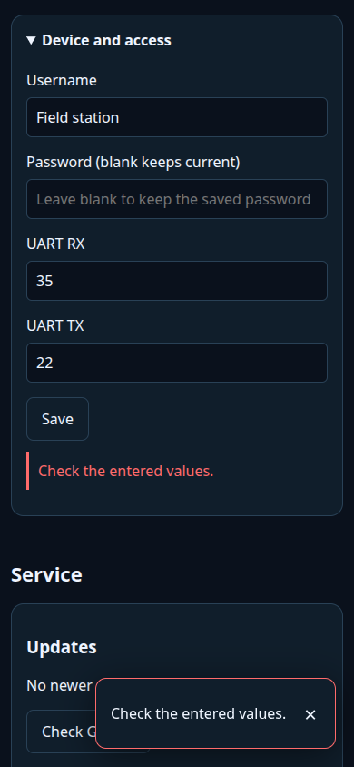

# HTTP API v2 and MQTT API 2

[English](api.md) | [Русский](api.ru.md)

All HTTP paths start with `/api/v2`. Use HTTP Basic Auth with the credentials
from the device settings. JSON POST requests require
`Content-Type: application/json`; the body limit is 2048 bytes.
Errors return `{"error":"stable_code"}`. The client selects English or Russian
messages; the web interface defaults to English.

| Method and path | Result |
|---|---|
| GET `capabilities` | API/firmware version, board, display, OTA, limits and release repository |
| GET `state` | Full snapshot, `boot_id`, `source_token`, `sequence`, `uptime_ms`, readings and age |
| GET `ws-token` | Single-use token valid for 10 seconds |
| WS `ws?t=<token>` | Full snapshots; at most two clients |
| POST `commands` | `202`, operation ID, `queued`/`running`/`done` and result |
| GET `commands/<UUID>` | The same operation after a connection loss |
| DELETE `commands/<UUID>` | Cancel an unstarted command; a started command returns 409 |
| GET/POST `config/<section>` | Read or partially update a section using its revision |
| GET `diagnostics` | Running image identity, heap/stacks, MQTT and LCD diagnostics |
| GET `mqtt` | Compact MQTT/TLS status and last error codes |
| POST/GET `network/scan` | Start asynchronous Wi-Fi discovery (`202`) / read stage and up to 12 networks |
| POST `reset` | `{ "confirm": true }`: restore defaults, retire legacy credentials and restart |
| POST `mqtt/reconnect` | Request orderly MQTT shutdown and reconnection |
| POST `restart` | Respond, then reboot |
| GET `update` | Stage, error, bytes, total size and active flag |
| POST `update/prepare` | Signed manifest; asynchronous preparation, `202` |
| POST `update/upload` | Binary body matching the declared size |
| POST `update/download` | `{"url":"https://…"}`; streaming Range downloads |
| POST `update/cancel` | Cancel before image activation |

Commands use the **recipient's uptime**, not the browser clock:

```json
{
  "command": "memory_tune",
  "request_id": "cb534da0-82e6-4009-b936-4a16daef876a",
  "source_token": "0123456789abcdef0123456789abcdef",
  "expires_uptime_ms": 125900
}
```

Read `source_token` and `uptime_ms` from a fresh snapshot. Add the elapsed time
since receiving it and a start deadline of no more than 2000 ms. Commands:
`memory_tune`, `full_tune`, `bypass`, `auto`, `manual`, `controlled`, `toggle`,
`antenna_1`, `antenna_2`, `external_antenna`. The simulator's external command also
requires `port: 1…16`.

The same ID with identical content returns the existing operation; different
content returns `duplicate_conflict`. The journal holds 16 operations. Unfinished
entries are not evicted; completed entries remain for at least 60 seconds.
A full journal returns `busy` before hardware is changed. Reboot clears the journal.
An `unknown_operation` after reboot does not authorize an automatic command retry.
Results distinguish `failed`, `timeout`, `unknown`, `expired`, `target_changed`,
`unsafe`, `unavailable` and `cancelled`.

`202` means acceptance, not completion. If the POST response is lost, first GET
the same ID. Do not generate a new ID while the hardware outcome is unknown.
WebSocket frames may be skipped: the next full snapshot restores the state.
Discard older sequence values within the same boot/source context.

Settings sections: `network`, `mqtt`, `radio`, `remote`, `tuning`, `antennas`,
`display`, `meter`, `device`. GET returns the section revision. POST:

```json
{"revision": 3, "value": {"enabled": false}}
```

Conflicts return HTTP 409 / `config_conflict`. Preserve the user's form, fetch the
current values for comparison, and retry only after the user chooses to save.
A blank password keeps the previous value; GET does not return secrets.
Network and UART changes return `restart_required`. Select CONTROLLED through
a command; the `tuning` section only configures its automation parameters.

OTA: after `prepare`, poll `update` until `receiving`. Waiting for hardware/RF and
connection cleanup can be cancelled. Only then send a BIN or URL. The image and
manifest must belong to the same package. `ready` means that the slot is already
activated and cancellation is too late.

## MQTT / Home Assistant / Logger Bridge

Topics are preserved from Remote-LDGControl: `ldg/tuner/<MAC>/status`, `state`,
`command`, `command/response` and `radio/state`, using the device's actual base.
Diagnostics expose the MAC device ID and full base topic.
Status and telemetry are retained; command responses are not. Home Assistant has
six sensors and seven buttons. `homeassistant/status=online` republishes discovery;
disabling discovery removes its retained configuration.

Port 8883 enables MQTT TLS with certificate and hostname verification. NTP time
is needed to validate certificate dates. MQTT errors do not block LDG or the web.

A simple HA command is `{"command":"memory_tune"}`. Logger Bridge commands also
send `request_id`, `source_token` and `expires_uptime_ms`, as in HTTP v2.
The response contains the command name, ID/context for extended requests and the
execution result. Retained commands are ignored. Deduplication and deadlines share
the command journal. The HTTP move to v2 does not change the MQTT API version.

A remote panel uses the same v2 API and requires `source=local` at its recipient.
An operation stays bound to its original recipient until completion. Changing the
panel's settings does not move an accepted command to another device.

## Errors in the web interface

Errors appear beside the action and in a notification inside the current viewport.
The form stays populated so the user can correct it and retry.



See the [interface guide](interface.md) for the corresponding user actions.

## USB API 1

The physical UART0 console uses 115200 baud, newline-delimited JSON and `ldg: 1`.
It is independent of HTTP API v2 and is never forwarded to LDG. Each client starts
with `hello` and a random 32-character hexadecimal `client`. Replies contain
`boot` (16 hexadecimal characters), `sid`, `cid` and HTTP-like `status`.
Subsequent `settings`, `apply` and `reboot` requests include `boot`, `sid` and a
strictly increasing `cid`. An exact retry returns the cached reply without
executing again; changed bodies or old sessions return 409. Maximum line length
is 1536 bytes. Settings replies expose only password-presence flags.

`apply` accepts `settings` with `wifiSSID`, `wifiPassword`, `clearWifiPassword`,
`mqttBroker`, `mqttPort`, `mqttUsername`, `mqttPassword`, `clearMqttPassword`,
`mqttDiscoveryEnabled`, `useStaticIP`, `staticIP`, `staticNetmask`,
`staticGateway` and `staticDNS`. Empty passwords preserve stored values; the
explicit clear flags delete them. Unknown keys and invalid types are rejected.
See [USB setup](usb-setup.md) for the browser flow and recovery actions.

HTTP `state` also includes `antenna_names` and the physical `tuner_mode`; `mode`
continues to describe the effective mode, including CONTROLLED. Network and MQTT
configuration accept `clear_password: true` to explicitly delete a stored secret.

## Shack Protocol v1.0

The read-only [Shack Protocol](https://github.com/ra3vld/shack-libs/tree/main/protocol) uses the controller's Wi-Fi MAC without separators as the node ID, and `tuner` as the device ID.

- HTTP exposes `/shack/v1/hello`, `/shack/v1/devices`, and `/shack/v1/devices/tuner/state`. Use GET with `Shack-Version: 1.0`, a unique `Shack-Request-Id`, and the controller's HTTP Basic credentials.
- USB accepts length-prefixed `@SHACK` requests on the provisioning serial connection. These reads use the same paths and leave the provisioning maintenance lease untouched.
- A firmware build with `-D LDG_SHACK_UDP=ON` serves binary Protobuf on UDP port 4536, bound to the Wi-Fi station address and restricted to its subnet. Enable this build option on a trusted LAN. The default build keeps this plain UDP binding disabled.
- On a user MQTT broker, send requests and receive replies with QoS 1 and retain disabled. Grant the client and controller access to the applicable `shack/v1/{node_id}/read/{request_id}/request` and `…/reply` topics.
