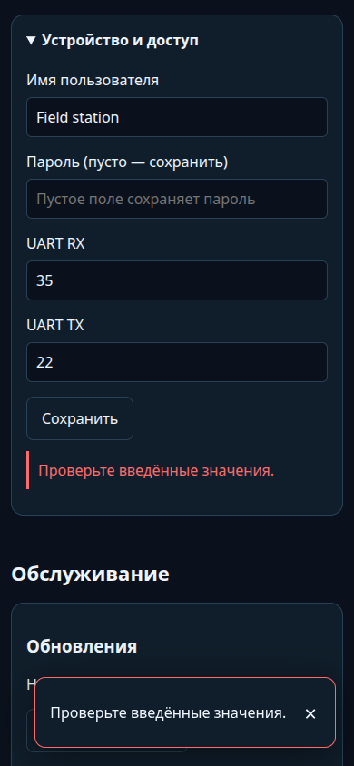

# HTTP API v2 и MQTT API 2

[English](api.md) | [Русский](api.ru.md)

Все HTTP пути имеют префикс `/api/v2`. Используйте HTTP Basic Auth с данными из
раздела устройства. POST JSON требует `Content-Type: application/json`, тело
ограничено 2048 байт. Ошибки возвращают `{"error":"стабильный_код"}`.
Человеческий текст EN/RU выбирает клиент; веб по умолчанию открывается на английском.

| Метод и путь | Результат |
|---|---|
| GET `capabilities` | Версия API/прошивки, плата, экран, OTA, лимиты, репозиторий релизов |
| GET `state` | Полный снимок, `boot_id`, `source_token`, `sequence`, `uptime_ms`, измерения и возраст |
| GET `ws-token` | Одноразовый токен на 10 секунд |
| WS `ws?t=<token>` | Полные снимки; максимум два клиента |
| POST `commands` | `202`, ID операции, `queued`/`running`/`done`, результат |
| GET `commands/<UUID>` | Состояние той же операции после потери соединения |
| DELETE `commands/<UUID>` | Отмена ещё не начатой команды; начатая возвращает 409 |
| GET/POST `config/<section>` | Чтение или частичное изменение раздела с ревизией |
| GET `diagnostics` | Отпечаток образа, память/стеки, диагностика MQTT и LCD |
| GET `mqtt` | Компактный статус MQTT/TLS и коды последней ошибки |
| POST/GET `network/scan` | Запуск поиска Wi-Fi (`202`) / этап и до 12 сетей |
| POST `reset` | `{ "confirm": true }`: сброс, удаление старых реквизитов и перезапуск |
| POST `mqtt/reconnect` | Запрос на штатное завершение и новое подключение MQTT |
| POST `restart` | Ответ, затем перезагрузка |
| GET `update` | Этап, ошибка, объём, общий размер и признак активности |
| POST `update/prepare` | Подписанный манифест; асинхронная подготовка, `202` |
| POST `update/upload` | Бинарное тело ровно объявленного размера |
| POST `update/download` | `{"url":"https://…"}`; потоковое получение Range-порциями |
| POST `update/cancel` | Отмена до активации образа |

Команда использует время **получателя**, а не часы браузера:

```json
{
  "command": "memory_tune",
  "request_id": "cb534da0-82e6-4009-b936-4a16daef876a",
  "source_token": "0123456789abcdef0123456789abcdef",
  "expires_uptime_ms": 125900
}
```

Возьмите `source_token` и `uptime_ms` из свежего снимка. Добавьте к uptime время
с момента получения и не более 2000 мс срока начала. Команды: `memory_tune`,
`full_tune`, `bypass`, `auto`, `manual`, `controlled`, `toggle`, `antenna_1`,
`antenna_2`, `external_antenna`. Последней нужен `port: 1…16` для симулятора.

Один ID с тем же содержимым возвращает существующую операцию; другое содержимое
даёт `duplicate_conflict`. Журнал содержит 16 операций, незавершённые записи
не вытесняются, завершённые удерживаются минимум 60 секунд. При переполнении
возвращается `busy` до отправки оборудованию. Перезагрузка очищает журнал.
`unknown_operation` после перезагрузки не разрешает автоматически повторять
физическую команду. Результаты различают `failed`, `timeout`, `unknown`,
`expired`, `target_changed`, `unsafe`, `unavailable` и `cancelled`.

`202` означает принятие, а не успех. После потери POST-ответа сначала выполните
GET по тому же ID. Не создавайте новый ID, пока неизвестно состояние оборудования.
WebSocket допускает пропуск кадров: следующий полный снимок восстанавливает
состояние. Клиент отбрасывает старые sequence внутри одного boot/source.

Разделы настроек: `network`, `mqtt`, `radio`, `remote`, `tuning`, `antennas`,
`display`, `meter`, `device`. Ответ GET содержит ревизию раздела. POST:

```json
{"revision": 3, "value": {"enabled": false}}
```

Конфликт даёт HTTP 409 / `config_conflict`. Сохраняйте введённую форму, получайте
новый снимок для сравнения и повторяйте только после выбора пользователя.
Пустой пароль сохраняет прежнее значение; секреты в GET не возвращаются.
Сеть и UART возвращают `restart_required`. Режим CONTROLLED выбирается командой,
а раздел `tuning` задаёт только параметры его автоматики.

OTA: после `prepare` опрашивайте `update` до `receiving`. Ожидание занятого
оборудования/передачи и очистка соединений допускают отмену. Только затем
передавайте BIN или URL. Файл и манифест должны быть из одного комплекта.
`ready` означает, что слот уже активирован; отменять его поздно.

## MQTT / Home Assistant / Logger Bridge

Топики сохранены от Remote-LDGControl: `ldg/tuner/<MAC>/status`, `state`, `command`,
`command/response`, `radio/state` с фактической базой, указанной устройством.
Идентификатор MAC и точное имя базовой темы видны в диагностике.
`status` и телеметрия retained, ответы команд — non-retained. Сохранены шесть
сенсоров и семь кнопок Home Assistant; `homeassistant/status=online` повторяет
discovery. Отключение discovery удаляет его retained-конфигурации.

Порт 8883 включает MQTT TLS с проверкой сертификата и имени сервера. Для проверки
срока сертификата требуется время NTP. Ошибка MQTT не блокирует LDG или веб.

Простая команда HA: `{"command":"memory_tune"}`. Команда Logger Bridge дополнительно
передаёт те же `request_id`, `source_token`, `expires_uptime_ms`, что и HTTP v2.
Ответ содержит исходное имя команды, ID/контекст для расширенного запроса и
результат исполнения. Retained-команды не исполняются. Дедупликация и срок
действия общие с журналом команд. Переход HTTP на v2 не меняет номер MQTT API.

Удалённая панель обращается к тому же v2 и требует у получателя `source=local`.
Получатель выполняемой операции закреплён до результата; изменение настроек
панели не переносит уже принятую команду на другое устройство.

## Ошибки в веб-интерфейсе

Ошибка показана рядом с действием и в уведомлении внутри видимой области.
Введённая форма сохраняется для исправления и повтора.



Подробнее — в [руководстве по интерфейсу](interface.ru.md).

## USB API 1

Физическая консоль UART0 работает на 115200 бод, принимает JSON по строкам с
`ldg: 1`. Она независима от HTTP API v2 и не пересылается в LDG. Клиент начинает
с `hello` и случайного `client` из 32 шестнадцатеричных символов. Ответ содержит
`boot` (16 шестнадцатеричных символов), `sid`, `cid` и HTTP-подобный `status`.
Следующие `settings`, `apply`, `reboot` передают `boot`, `sid` и возрастающий
`cid`. Точный повтор возвращает сохранённый ответ без повторного исполнения;
изменённое тело или старый сеанс дают 409. Предел строки — 1536 байт. Ответ
настроек содержит только признаки наличия паролей.

`apply` принимает `settings`: `wifiSSID`, `wifiPassword`, `clearWifiPassword`,
`mqttBroker`, `mqttPort`, `mqttUsername`, `mqttPassword`, `clearMqttPassword`,
`mqttDiscoveryEnabled`, `useStaticIP`, `staticIP`, `staticNetmask`,
`staticGateway`, `staticDNS`. Пустой пароль сохраняет прежний; явный флаг очистки
удаляет его. Неизвестные поля и неверные типы отклоняются. Сценарий браузера и
восстановление описаны в [руководстве USB](usb-setup.ru.md).

HTTP `state` дополнен `antenna_names` и физическим `tuner_mode`; `mode`
по-прежнему описывает эффективный режим, включая CONTROLLED. Разделы сети и MQTT
принимают `clear_password: true` для явного удаления сохранённого пароля.
