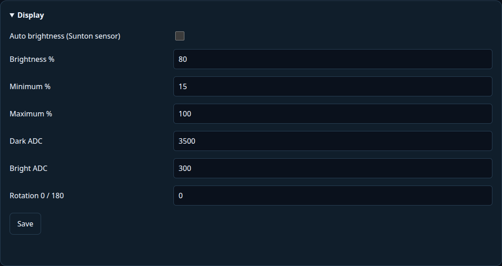

# Boards and wiring

[English](hardware.md) | [Русский](hardware.ru.md)

LDG UART: **38400, 8N1**. Connect the controller RX to the interface adapter TX
and the controller TX to the adapter RX. A common GND and suitable level conversion
are required. ESP32 GPIOs must not connect directly to RS-232 or 5 V signals.

| Profile | UART RX | UART TX | Voltage used for power calculations |
|---|---:|---:|---|
| headless | GPIO16 | GPIO17 | ADC GPIO34, 100 kΩ / 22 kΩ divider; configured fallback outside 8–18 V |
| sunton | GPIO35 | GPIO22 | Configurable; 13.8 V by default |
| guition | Unassigned | Unassigned | Configurable; 13.8 V by default |

## Sunton ESP32-3248S035C

ST7796: SPI SCLK14, MOSI13, CS15, DC2, backlight27. GT911: SDA33, SCL32,
RESET25, address 0x5D or 0x14. The ambient-light sensor uses ADC GPIO34;
it cannot also measure the tuner supply voltage.
Only landscape 0° and 180° are available, with matching touch coordinates.

Automatic brightness calibration is under **Display**: dark and bright ADC values,
minimum brightness and maximum brightness. Diagnostics show the current sensor
reading. If the sensor fails, manual brightness is used.

## Guition ESP32-4848S040

The profile targets ESP32-S3, 16 MB Flash, octal PSRAM, ST7701 RGB and GT911.
Before connecting LDG, check the board revision, memory markings and connector
pinout. UART is disabled by default so that the display and network panel can be
set up first.

Reserved GPIOs: RGB `4,5,6,7,15,8,20,3,46,9,10,11,12,13,14,0`,
HSYNC16, VSYNC17, DE18, PCLK21; ST7701 control CS39/SCLK48/SDA47;
touch SDA19/SCL45; backlight38. Do not assign these pins to LDG.

Under **Device and access**, choose two different spare pins from
GPIO1/2/40/41/42. First check that the selected pins are exposed on your board
revision and unused by other peripherals. Restart after saving.
`-1/-1` disables UART. A remote panel does not require UART pins.

## External antenna switch

Enable the simulator in the antenna settings. It confirms a software request;
it does not drive relays or report a physical position.
Each band has independent LDG and external ports; zero means **Leave unchanged**.
A manual selection stays in effect until the band changes.

The external port changes only after a fresh measured zero-RF reading. With active
TCI, consistent RX/TX and TUNE data are also required. A failed LDG part of a route
does not cause automatic reverse switching. A real switch requires its own driver
and wiring instructions.

## Display settings

Landscape rotation and brightness are available in the web **Display** section.

See the [interface guide](interface.md) for control and recovery actions.
