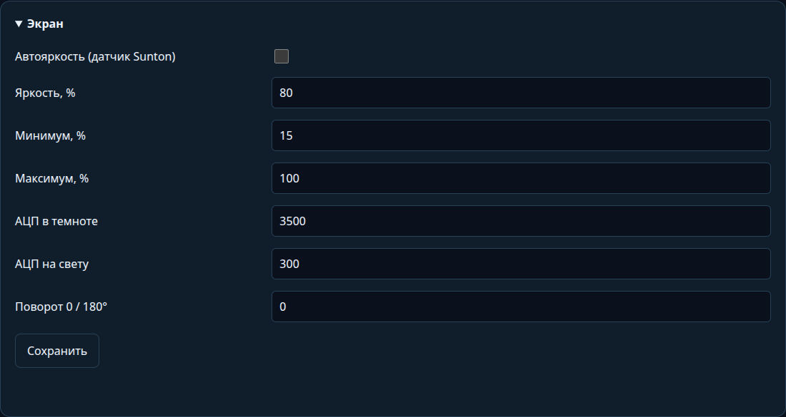

# Платы и подключение

[English](hardware.md) | [Русский](hardware.ru.md)

UART LDG: **38400, 8N1**. RX контроллера подключается к TX интерфейсного адаптера,
TX контроллера — к RX адаптера. Нужны общий GND и согласование электрических уровней.
GPIO ESP32 не предназначены для прямого подключения к RS-232 или 5-В сигналу.

| Профиль | UART RX | UART TX | Напряжение для расчёта мощности |
|---|---:|---:|---|
| headless | GPIO16 | GPIO17 | ADC GPIO34 с делителем 100 кОм / 22 кОм; при значении вне 8–18 В — настройка |
| sunton | GPIO35 | GPIO22 | Настраиваемое, по умолчанию 13,8 В |
| guition | Не назначен | Не назначен | Настраиваемое, по умолчанию 13,8 В |

## Sunton ESP32-3248S035C

ST7796: SPI SCLK14, MOSI13, CS15, DC2, подсветка27. GT911: SDA33, SCL32,
RESET25, адрес 0x5D или 0x14. Датчик освещённости использует ADC GPIO34;
его нельзя одновременно использовать для измерения питания тюнера.
Доступны горизонтальные 0° и 180°, с соответствующим преобразованием touch.

Калибровка автояркости находится в разделе экрана: значения АЦП в темноте и на
свету, минимальная и максимальная яркость. Текущее значение датчика есть в
диагностике. При отказе датчика применяется ручная яркость.

## Guition ESP32-4848S040

Профиль рассчитан на ESP32-S3, 16-МБ Flash, octal PSRAM, ST7701 RGB и GT911.
Перед подключением LDG сверьте ревизию платы, маркировку памяти и схему разъёмов.
UART по умолчанию выключен; это позволяет сначала запустить экран и сетевую панель.

Используемые GPIO: RGB `4,5,6,7,15,8,20,3,46,9,10,11,12,13,14,0`,
HSYNC16, VSYNC17, DE18, PCLK21; управление ST7701 — CS39/SCLK48/SDA47;
touch SDA19/SCL45; подсветка38. Не назначайте эти выводы под LDG.

В «Устройство и доступ» можно выбрать два разных свободных вывода из
GPIO1/2/40/41/42. Сначала проверьте, что выбранные выводы действительно выведены
на разъём вашей ревизии и не заняты периферией. После сохранения перезапустите
плату. `-1/-1` отключает UART. Роль удалённой панели не требует назначения UART.

## Внешний переключатель

Симулятор включается в разделе антенн и подтверждает только выполнение
программного запроса. Он не управляет реле и не подтверждает физическое положение.
Для каждого диапазона задаются независимые LDG- и внешние порты; ноль означает
«не переключать». Ручной выбор удерживается до смены диапазона.

Внешний порт меняется только после свежего измеренного нуля RF. При активном TCI
дополнительно нужны согласованные данные RX/TX и TUNE. Ошибка LDG-части маршрута
не вызывает автоматического обратного переключения. Подключение настоящего
переключателя требует соответствующего драйвера и его электрической схемы.

## Настройки экрана

Горизонтальный поворот и яркость доступны в разделе «Экран» веб-интерфейса.

Подробнее — в [руководстве по интерфейсу](interface.ru.md).
