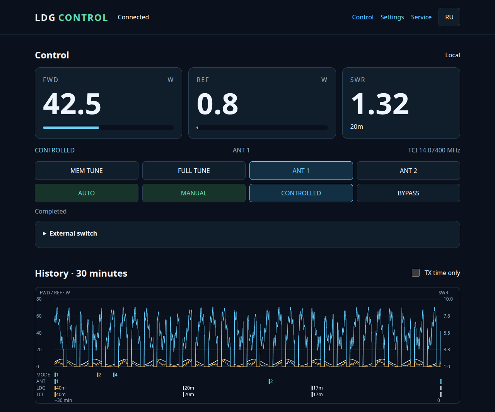
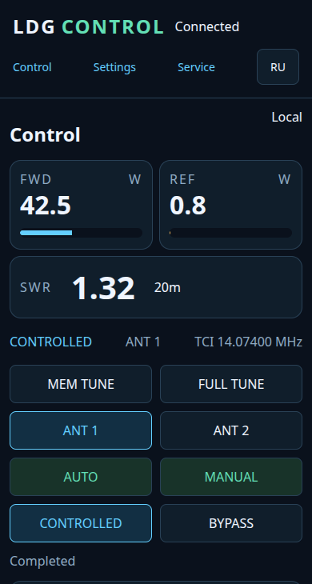
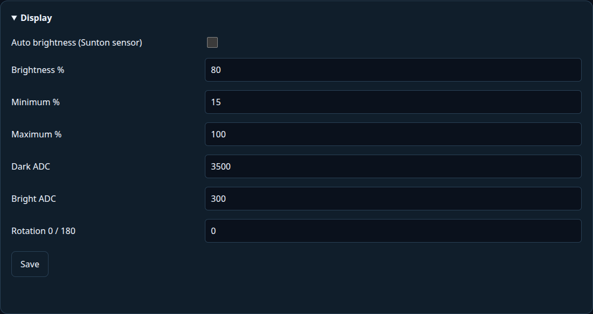
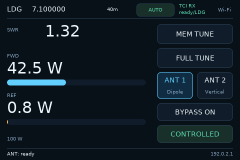
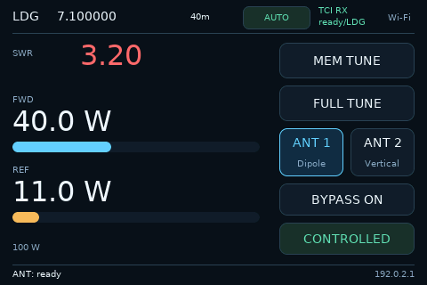
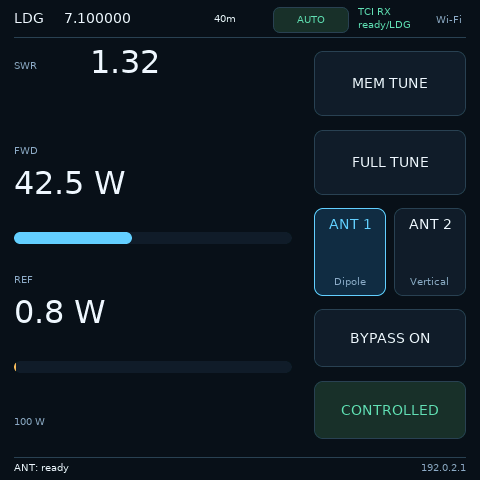
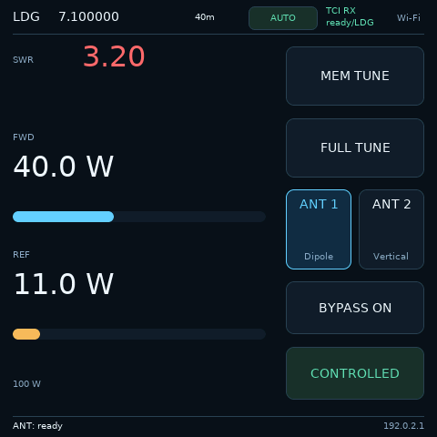
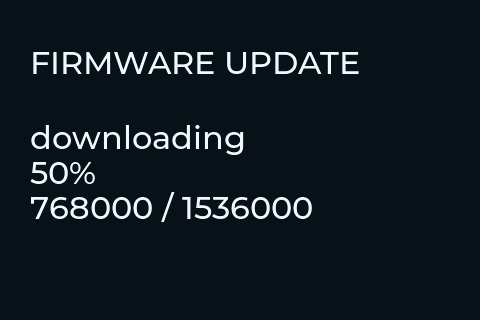
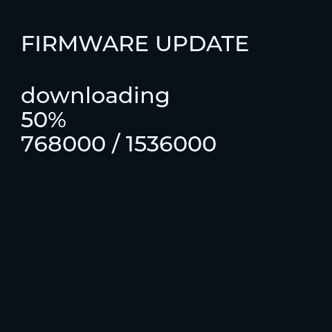
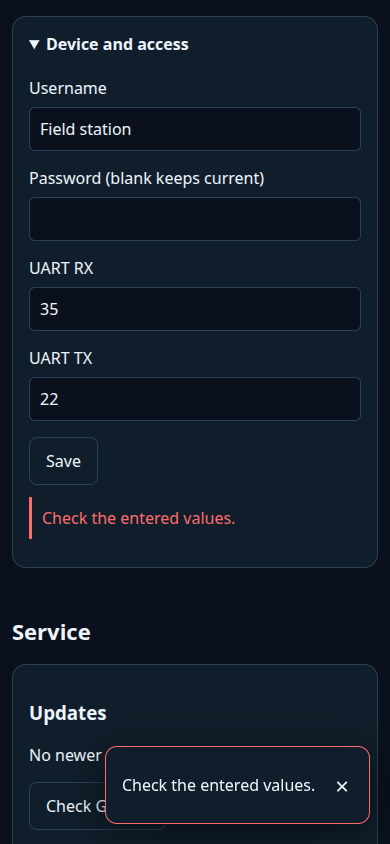

# Web interface and device display

[English](interface.md) | [Русский](interface.ru.md)

## Language

The first visit uses English regardless of the browser's language. Click **RU**
in the top bar to switch to Russian and **EN** to return to English. Your choice
is remembered in that browser. Switching languages keeps forms, their values and
current messages. If browser storage is unavailable, the switch still works for
the current page; the next visit starts in English.

## Controls and history

The main page shows FWD, REF, SWR, the band, operating mode, antenna and TCI
frequency. MEM TUNE and FULL TUNE start different tuning operations. ANT1/ANT2
select a named port. Pressing BYPASS again returns to AUTO.

A command is first accepted and then reports its result. When a result is unknown,
check the tuner state before sending a new command. Missing readings appear as
dashes rather than zero power.

The screenshots use example telemetry. Charts are at the bottom of the main page.
They retain 30 minutes in the browser and show power, SWR and mode/antenna/band
changes. **TX time only** skips receive pauses. Switching this recording mode
starts a new history. Charts load in the background; if loading fails, their
**Retry** button reloads them while controls stay available.

### Mobile view

Controls rearrange into two columns on a narrow screen.

## Settings

Open only the sections you need. Wi-Fi, MQTT, TCI, a remote tuner and the external
switch are independent options and can remain disabled. Saving settings reports
whether a restart is required. A blank password keeps the current password.

The **Display** section controls brightness, Sunton automatic brightness,
and landscape rotation. The device shows numeric readings and power bars.

See [boards and wiring](hardware.md) for sensor and pin assignments.

## Device display

The touchscreen shows FWD and REF power, SWR, band, mode and antenna, with
buttons for tuning, antenna selection and operating mode. Its labels use English;
the browser language switch does not change the device display.
The images below are LVGL screen captures with example telemetry.

The display uses numeric FWD, REF and SWR readings with separate power bars.
The bar range and logarithmic scale follow the web **Meters** settings. High SWR
changes the readout to amber above 1.5 and red above 2.0. The right column keeps
the original MEM TUNE, FULL TUNE, ANT 1/2, BYPASS and mode controls.
The mode button cycles AUTO → CONTROLLED → MANUAL → AUTO; its label names the
next action. Antenna buttons show the configured names and highlight the confirmed
selection.

### Sunton — 480×320

Numeric view:

High SWR:

### Guition — 480×480

Numeric view:

High SWR:

### Firmware update

During an update, the display shows its stage, percentage and transferred/total
bytes. The controls return after cancellation or failure.

Sunton:

Guition:

## Errors and saving conflicts

A failed action shows its reason beside the button and in a notification inside
the visible area. The notification expires after eight seconds and pauses while
hovered or focused. Its close button dismisses it immediately. The section keeps
the error and form values so that they can be corrected before retrying.

If another window changed the same settings section, select **Load current values**
to compare. Your input remains in the form. **Save my version** explicitly applies
your values against the loaded revision. For protocol details, see [API v2](api.md).

## Updates and diagnostics

**Service** offers a manual GitHub check, release installation, offline file
upload and diagnostics. A file upload needs both the BIN and its matching signed
manifest. Preparation can wait for a hardware operation or transmission to finish.
Use **Cancel** before image activation to stop an update. Modules resume after
cancellation or failure; the current firmware remains available.

Diagnostics can be refreshed without opening additional connections. **Reconnect
MQTT** requests a reconnection without rebooting the controller. **Restart device**
asks for confirmation before restarting it.
