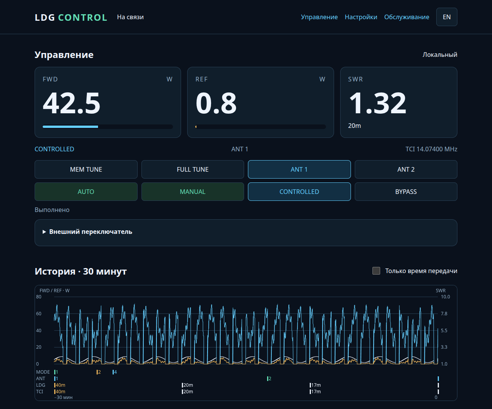
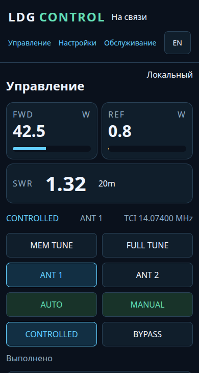
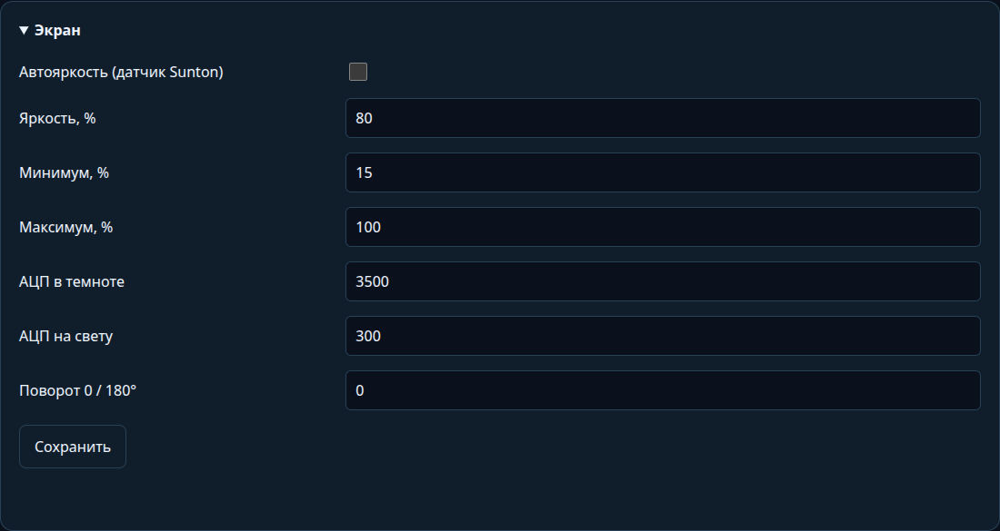
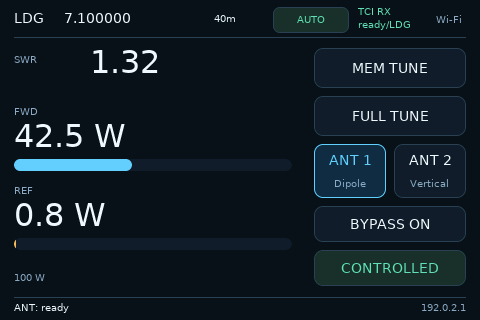
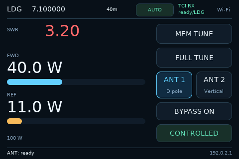
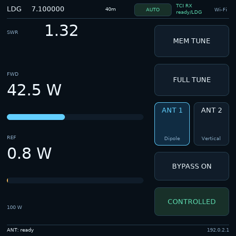
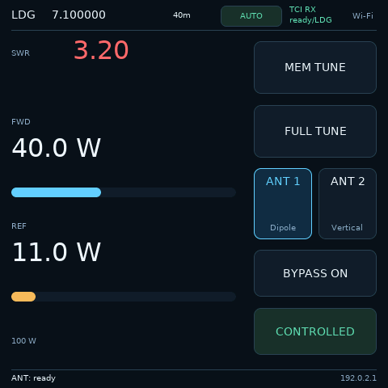
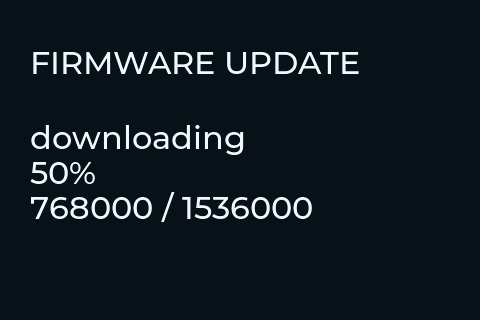
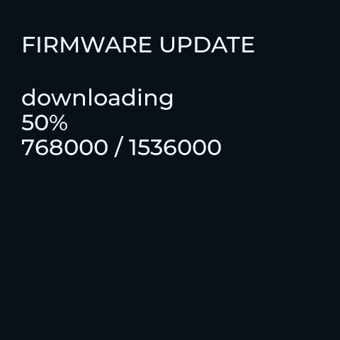
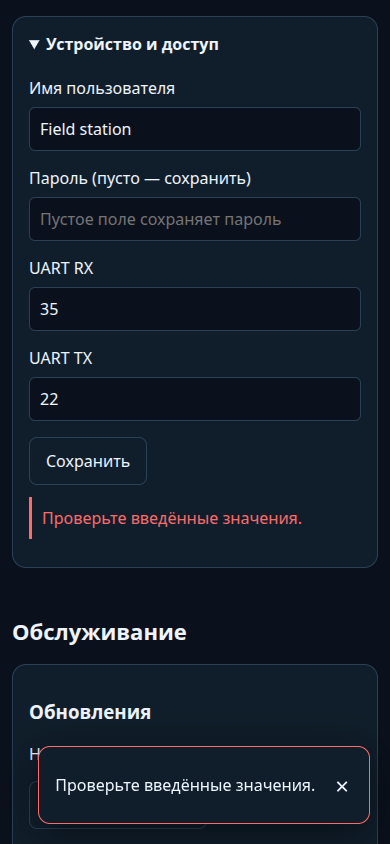

# Веб-интерфейс и дисплей устройства

[English](interface.md) | [Русский](interface.ru.md)

## Язык

При первом открытии используется английский независимо от языка браузера.
Нажмите **RU** в верхней панели, чтобы перейти на русский, и **EN**, чтобы вернуть
английский. Выбор запоминается в этом браузере. При переключении сохраняются формы,
введённые значения и текущие сообщения. Если хранилище браузера недоступно,
переключатель работает для текущей страницы; следующее открытие начнётся на английском.

## Управление и история

Главная страница показывает FWD, REF, SWR, диапазон, режим, антенну и частоту TCI.
MEM TUNE и FULL TUNE запускают разные операции настройки. ANT1/ANT2 выбирают
именованный порт. BYPASS сохраняет CONTROLLED; повторное нажатие возвращает CONTROLLED, если он включён, иначе AUTO.

Сначала команда принимается, затем появляется результат. Если он неизвестен,
проверьте состояние тюнера перед новой командой. Отсутствующие измерения показаны
прочерками, а не нулевой мощностью.

На скриншотах используется пример телеметрии. Графики находятся внизу главной
страницы. Они сохраняют 30 минут в браузере и показывают мощность, SWR, изменения
режима, антенны и диапазонов. «Только время передачи» использует свежие TCI TRX/TUNE, включая SSB-паузы при нулевой мощности. Без известного TCI используется свежая положительная мощность LDG. Паузы приёма пропускаются; разные передачи не соединяются линией.
Переключение режима записи начинает новую историю. Графики загружаются в фоне;
при ошибке их кнопка «Повторить» загружает модуль заново, пока управление остаётся
доступным.

### Мобильный вид

На узком экране кнопки управления располагаются в две колонки.

## Настройки

В [руководстве USB и восстановления](usb-setup.ru.md) описаны привязка к сервису,
адреса `.local`, поиск Wi-Fi, явное удаление паролей и сброс настроек.

Открывайте только нужные разделы. Wi-Fi, MQTT, TCI, удалённый тюнер и внешний
переключатель независимы и могут оставаться выключенными. После сохранения
появляется сообщение, если нужен перезапуск. Пустой пароль сохраняет прежнее значение.

Раздел «Экран» управляет яркостью, автояркостью Sunton и горизонтальным поворотом.
Дисплей показывает цифры и полосы мощности.

Выводы и датчики описаны в [руководстве по подключению](hardware.ru.md).

## Дисплей устройства

Сенсорный экран показывает прямую и отражённую мощность FWD и REF, КСВ (SWR),
диапазон, режим и антенну. Кнопки управляют настройкой, выбором антенны и режимом
работы. Надписи дисплея английские; переключение языка в браузере их не меняет.
Ниже приведены снимки экранов LVGL с примером телеметрии.

Дисплей показывает FWD, REF и КСВ цифрами, с отдельными полосами мощности.
Предел и логарифмическая шкала полос задаются в разделе «Измерители» веб-интерфейса.
При КСВ выше 1,5 показание становится янтарным, выше 2,0 — красным. Справа
сохранены кнопки исходного интерфейса: MEM TUNE, FULL TUNE, ANT 1/2, BYPASS и режим.
Кнопка режима переключает AUTO → CONTROLLED → MANUAL → AUTO; её надпись указывает
следующее действие. Кнопки антенн показывают заданные названия и выделяют
подтверждённый выбор.

### Sunton — 480×320

Цифровой вид:

Высокий КСВ:

### Guition — 480×480

Цифровой вид:

Высокий КСВ:

### Обновление прошивки

Во время обновления дисплей показывает этап, процент и количество
переданных/всех байт. После отмены или ошибки возвращается управление тюнером.

Sunton:

Guition:

## Ошибки и конфликты сохранения

Ошибка действия показана рядом с кнопкой и в уведомлении внутри видимой области.
Уведомление исчезает через восемь секунд; таймер приостанавливается при наведении
или фокусе. Кнопка закрытия убирает его сразу. В разделе сохраняются причина ошибки
и введённые значения, чтобы их можно было исправить перед повтором.

Если другое окно изменило тот же раздел, выберите «Загрузить актуальные значения»
для сравнения. Ваш ввод останется в форме. «Сохранить мой вариант» явно применяет
ваши значения с учётом загруженной ревизии. Подробности протокола — в [API v2](api.ru.md).

## Обновления и диагностика

В разделе «Обслуживание» доступны ручная проверка GitHub, установка релиза,
загрузка файлов без Интернета и диагностика. Для загрузки нужны BIN и соответствующий
подписанный манифест. Подготовка может ожидать завершения аппаратной операции
или передачи. Нажмите «Отменить» до активации образа, чтобы остановить обновление.
После отмены или ошибки модули возобновляют работу, действующая прошивка остаётся
доступной.

Диагностика обновляется по запросу без дополнительных подключений.
«Переподключить MQTT» запрашивает новое соединение без перезагрузки контроллера.
«Перезапустить устройство» запрашивает подтверждение перед перезапуском.
