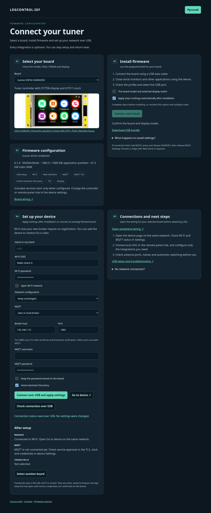
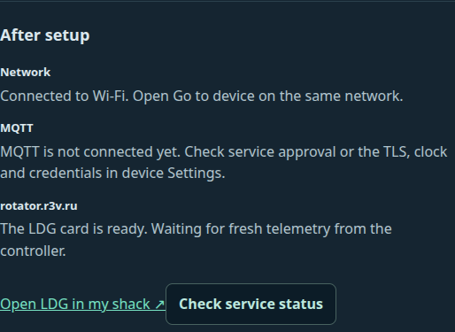
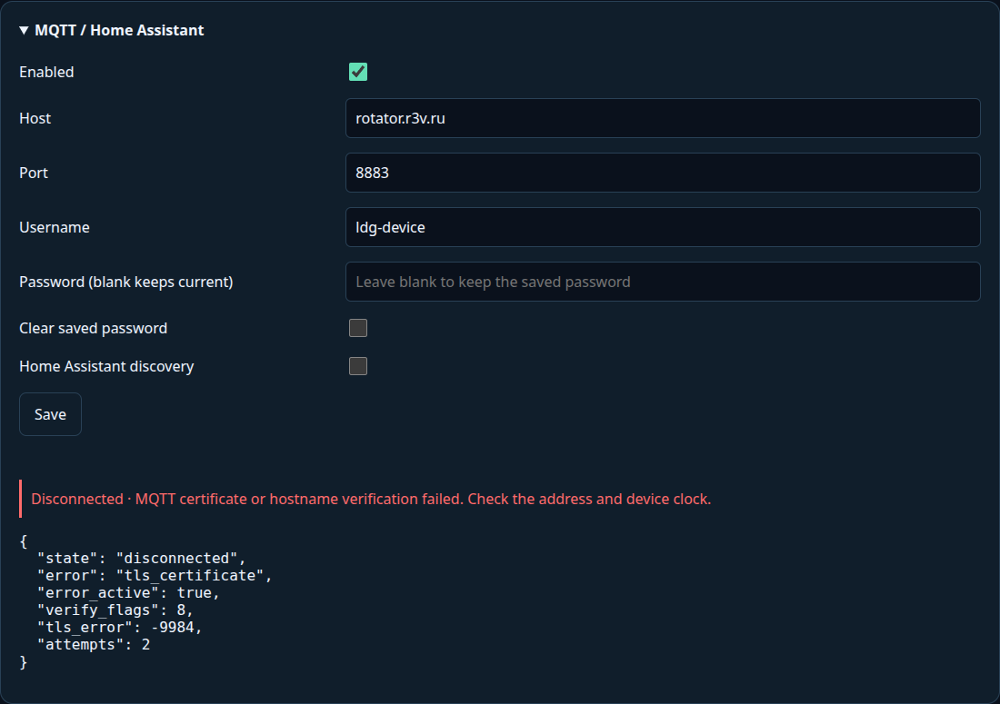

# USB installation and rotator.r3v.ru

[English](usb-setup.md) | [Русский](usb-setup.ru.md)

## Install or configure

Open the [USB installer](https://ra3vld.github.io/LDGControl-IDF/) in desktop Chrome
or Edge. Connect a USB data cable and close other serial monitors. Select exactly
**headless**, **Sunton ESP32-3248S035C** or **Guition ESP32-4848S040**, matching the
board and its memory. See [wiring](hardware.md) before attaching LDG.

The configurator follows five numbered sections. On a desktop, board and
configuration are on the left, installation on the right, with setup and
connections below. On a phone they follow the same numbered order.

1. **Select your board.** Match the model, memory and display.
2. **Firmware configuration.** Check the included functions and prepared build.
   Optional services start after configuration; select the local-controller or
   remote-panel role later in the device settings.
3. **Install firmware.** Confirm the hardware and select **Connect and install**.
   **Apply step 4 settings automatically after installation** is enabled by
   default: fill step 4 before installing, or uncheck it to configure later.
   The install dialog offers **Erase device**. Erasing removes all settings;
   leave it disabled to preserve NVS. First migration from the parent firmware
   requires the complete USB bundle, including bootloader and partition table.
4. **Set up your device.** Enter Wi-Fi and optionally choose your own broker or
   **rotator.r3v.ru · add LDG to my shack**. **Keep unchanged** preserves stored
   values; every integration can be skipped. **Open Wi-Fi network** explicitly
   removes the Wi-Fi password. For a private broker, uncheck **Keep the password
   stored on the board** to replace it; an empty replacement deletes it.
   **Connect over USB and apply settings** also configures an already flashed
   board. After flashing, USB setup starts automatically if enabled in step 3.
5. **Connections and next steps.** Open the selected board's wiring, choose your
   device role and configure the integrations you need. Check antenna ports,
   names and automatic switching before use.

Settings are saved and read back over USB; after a required restart, the same
physical board and its saved settings are checked again. **After setup** shows
network, MQTT and service status separately. Wi-Fi may take up to 25 seconds to
connect after a network change. A saved configuration does not by itself prove
an MQTT connection or fresh service telemetry.

**Go to device** stays visible beside the apply button and opens a new tab after
USB confirms a valid Wi-Fi address. Connect the computer to the same network.
**Check connection over USB** reads current status without writing settings.
The previous address is cleared on a new attempt, installation, profile change
or **Select another board**. If offline, join the `LDGControl-IDF` access point
with password `ldgcontrol`, then use **Open access-point page** in step 5.
You can correct Wi-Fi and retry without reinstalling.

During an active USB session tuner commands and automation pause; an ongoing
hardware operation or confirmed transmission must finish before applying or
rebooting. Closing USB setup releases the pause after five seconds. Reading or
setting up an unconnected tuner is allowed.

Installer shown with example settings.

Use **Stop setup** to cancel pending setup. A failed write keeps the form and
lets you retry. Keep the tab open while an issued service password awaits
confirmation. **Start a new link** and **Select another board** request explicit
confirmation before abandoning an unconfirmed password. USB errors appear beside
the action and in a visible notification that expires after eight seconds.

If the board is not detected, hold BOOT, press and release EN/RESET, then release
BOOT. Use its USB-to-UART bridge or a suitable external UART0 adapter. On Guition,
check the revision and console connector: the USB API uses the UART0 console at
115200 baud, separate from the LDG UART. The ESP Web Tools installation dialog
uses its own English labels.

## Add LDG to your shack

Choose **rotator.r3v.ru · add LDG to my shack**. After the installer identifies the
physical board, open **Sign in and approve LDG linking** and approve the device in
your account. The page polls the approved session, receives device-specific MQTT
credentials, writes them over USB and verifies them before acknowledging the
service. A remote panel cannot register as the local tuner controller.

The installer adds the LDG card automatically after you approve linking and
writes its MQTT credentials with verified TLS on port 8883. It acknowledges
credential delivery only after USB readback, including after a required reboot.
**Check service status** refreshes administrator approval, blocked/disabled
access and fresh telemetry without rewriting credentials. An outage keeps the
saved settings and offers a retry. If `ERR_BLOCKED_BY_CLIENT` appears, allow
requests to `rotator.r3v.ru` in the ad blocker for `ra3vld.github.io` and retry in
the same tab. Changing profiles with an unconfirmed service password is blocked
until you confirm it or explicitly choose **Select another board**.

Wi-Fi and private broker passwords go only to the board. The service receives
the device ID, shack name and a temporary PKCE challenge. Issued credentials stay
in this tab's memory until verification; they are not stored in browser storage.
The resulting card can remain offline or await administrator approval. Check
**MQTT / Home Assistant** on the local device page for the actual connection
state. Account linking does not require live RF or a connected LDG.

## MQTT TLS troubleshooting

The managed broker is `rotator.r3v.ru`, port **8883**. This port enables certificate
and hostname verification. It uses ISRG Root X2 for this host; other TLS brokers
use the SDK certificate bundle. Plain MQTT uses other configured ports.

Open **Settings → MQTT / Home Assistant**. The status distinguishes:

- clock synchronization: check DNS and access to NTP;
- insufficient internal memory or largest free block: disconnect extra clients,
  then use **Reconnect MQTT**;
- certificate/hostname or TLS handshake failure: check the host, clock and codes;
- rejected credentials or authorization: correct the login/password, or check
  approval and enabled/blocked state on rotator.r3v.ru;
- transport loss: check Wi-Fi, DNS, broker port and network access.

A failed connection is retried after a delay, with clock and memory checked on
every attempt. Disabling MQTT releases its client. Changing credentials ends the
old client before using the new settings. Fresh stable and zero-power telemetry
is published at one-second intervals; unknown/stale measurements remain unknown.
The tuner and web settings remain available when MQTT fails.

Example connection error.

**Service → Diagnostics** includes the firmware version, board, Git commit,
`source_digest` and `firmware_id` (the running application's ELF SHA-256). It also
shows heap, task stacks, control-loop timings, LCD service/flush timings, touch
errors and backlight state. Compare the fingerprint with the build you intended
to install before diagnosing a device.

## Local addresses and recovery

On a network with mDNS support, open `http://ldgcontrol-remote.local/` for headless
or `http://ldgcontrol-display.local/` for display profiles. With multiple devices
or a network that filters mDNS, use the IP address shown by your router or USB
setup. The `LDGControl-IDF` access point and `http://192.168.4.1/` remain available.

**Wi-Fi and network → Find Wi-Fi networks** scans asynchronously. Choose an SSID,
enter its password, save and restart if requested. A scan may wait for a TLS
connection to finish; failed scans can be retried.

A blank password preserves the existing secret. **Clear saved password** explicitly
removes it when saved. Explicit deletion also removes the old migration backup;
other active settings remain. The Wi-Fi driver uses RAM storage; its old SDK
credential copy is cleared during startup. Storage errors appear in diagnostics.
**Service → Reset settings** confirms deletion,
restores defaults and restarts. Afterwards reconnect to `LDGControl-IDF`, password
`ldgcontrol`, and sign in with `admin` / `change_me_please`. If the web password is
lost, reinstall over USB using **Erase device**, then configure the board again.
