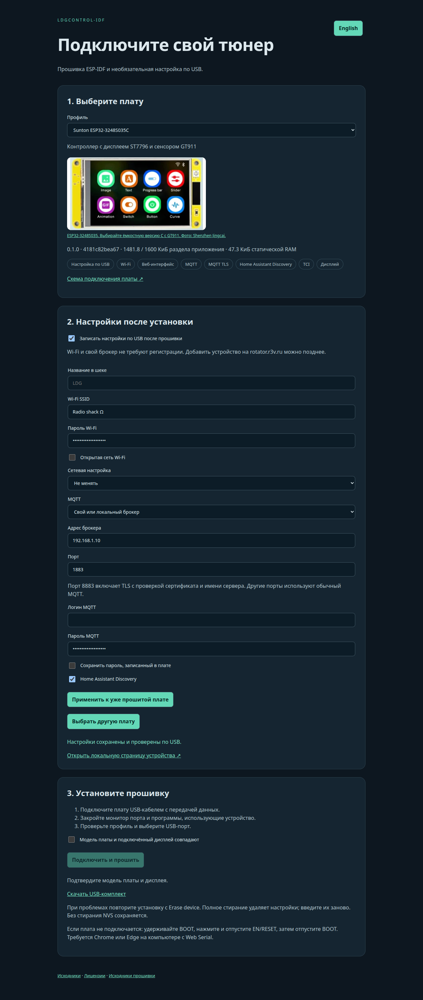
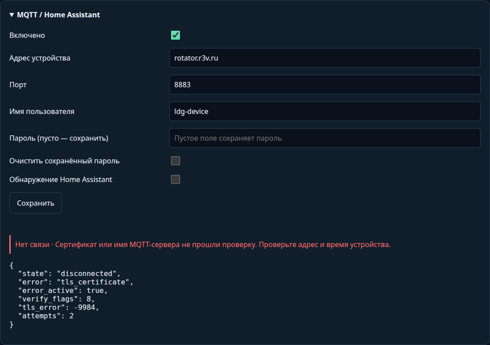

# Установка по USB и rotator.r3v.ru

[English](usb-setup.md) | [Русский](usb-setup.ru.md)

## Установка и настройка

Откройте [USB-прошивальщик](https://ra3vld.github.io/LDGControl-IDF/) в Chrome или
Edge на компьютере. Подключите кабель USB с передачей данных и закройте мониторы
порта. Выберите **headless**, **Sunton ESP32-3248S035C** или **Guition
ESP32-4848S040** в соответствии с платой и её памятью. Перед подключением LDG
изучите [подключение](hardware.ru.md).

1. Выберите плату и подтвердите модель платы и дисплея.
2. При необходимости включите «Записать настройки по USB после прошивки». Задайте
   Wi-Fi и выберите сохранение, настройку или отключение MQTT. Поля «Не менять»
   сохраняют прежние значения. «Открытая сеть Wi-Fi» явно удаляет пароль Wi-Fi.
   Для своего брокера снимите «Сохранить пароль, записанный в плате», чтобы
   заменить пароль; пустая замена удаляет его.
3. Нажмите «Подключить и прошить» и выберите порт. Диалог установки предлагает
   **Erase device**. Стирание удаляет настройки; отключите его для сохранения NVS.
   Первый переход с родительской прошивки требует полного USB-комплекта,
   включая загрузчик и таблицу разделов.
4. Дождитесь установки. При включённой настройке USB прошивальщик освобождает порт
   и подключается к приложению. Настройки записываются и читаются обратно; если
   требуется перезапуск сети, чтение повторяется после перезагрузки.

«Применить к уже прошитой плате» настраивает без перепрошивки. На время активного
сеанса USB команды тюнера и автоматика приостанавливаются. Перед сохранением и
перезагрузкой нужно дождаться завершения аппаратной операции и подтверждённой
передачи. После закрытия USB пауза снимается через пять секунд. Подключённый LDG
для чтения и настройки не требуется.

«Остановить настройку» отменяет ожидающую настройку. При ошибке записи форма
сохраняется и можно повторить попытку. Не закрывайте вкладку, пока выданный
сервисом пароль не подтверждён. «Начать новую привязку» и «Выбрать другую плату»
запрашивают подтверждение перед отказом от неподтверждённого пароля. Ошибка USB
видна рядом с действием и в уведомлении, исчезающем через восемь секунд.

Если плата не определяется, удерживайте BOOT, нажмите и отпустите EN/RESET, затем
отпустите BOOT. Используйте мост USB–UART платы или подходящий внешний адаптер
UART0. На Guition проверьте ревизию и разъём консоли: USB API использует консоль
UART0, 115200 бод, отдельно от UART тюнера. Диалог установки ESP Web Tools
использует собственные английские подписи.

## Добавление LDG в свой шек

Выберите «rotator.r3v.ru · добавить LDG в мой шек». После определения физической
платы откройте «Войти и подтвердить привязку LDG» и разрешите добавление устройства
в своей учётной записи. Страница опрашивает одобренный сеанс, получает отдельные
реквизиты MQTT, записывает их по USB и проверяет перед подтверждением сервису.
Удалённая панель не регистрируется как локальный контроллер тюнера.

Wi-Fi и пароль своего брокера передаются только плате. Сервис получает ID
устройства, название в шеке и временный PKCE challenge. Выданные реквизиты остаются
в памяти вкладки до проверки; в хранилище браузера они не записываются. Созданная
карточка может быть офлайн или ожидать одобрения администратора. Фактическое
подключение проверяйте в «MQTT / Home Assistant» локальной страницы устройства.
Привязка не требует RF и подключённого LDG.

## Диагностика MQTT TLS

Управляемый брокер — `rotator.r3v.ru`, порт **8883**. На этом порту проверяются
сертификат и имя сервера. Для этого адреса используется ISRG Root X2, для других
TLS-брокеров — набор сертификатов SDK. Другие настроенные порты используют
обычный MQTT.

Откройте «Настройки → MQTT / Home Assistant». Статус различает:

- ожидание времени: проверьте DNS и доступ к NTP;
- нехватку внутренней памяти или крупного блока: отключите лишние клиенты и
  нажмите «Переподключить MQTT»;
- ошибку сертификата, имени или TLS handshake: проверьте адрес, время и коды;
- отказ в реквизитах или доступе: исправьте логин/пароль либо проверьте одобрение
  и включённый/заблокированный доступ на rotator.r3v.ru;
- потерю транспорта: проверьте Wi-Fi, DNS, порт брокера и доступ к сети.

Неудачное подключение повторяется с задержкой; время и память проверяются при
каждой попытке. Отключение MQTT освобождает клиент. Изменение реквизитов завершает
старый клиент до применения новых параметров. Свежие стабильные и нулевые
измерения публикуются раз в секунду; неизвестные и устаревшие значения остаются
неизвестными. Ошибка MQTT не закрывает тюнер и настройки веба.

«Обслуживание → Диагностика» содержит версию, плату, Git-коммит, `source_digest`
и `firmware_id` — SHA-256 ELF работающего приложения. Также показаны память,
стеки задач, задержки управления, время обслуживания и вывода LCD, ошибки touch
и состояние подсветки. Перед диагностикой сверяйте отпечаток с нужной сборкой.

## Локальные адреса и восстановление

В сети с mDNS откройте `http://ldgcontrol-remote.local/` для headless или
`http://ldgcontrol-display.local/` для плат с экраном. При нескольких устройствах
или фильтрации mDNS используйте IP из роутера или настройки USB. Точка доступа
`LDGControl-IDF` и `http://192.168.4.1/` остаются доступны.

«Wi-Fi и сеть → Найти Wi-Fi» выполняет асинхронный поиск. Выберите SSID, введите
пароль, сохраните и перезапустите устройство, если запрошено. Поиск может ждать
завершения TLS-подключения; после ошибки его можно повторить.

Пустой пароль сохраняет действующий. «Очистить сохранённый пароль» явно удаляет
его при сохранении. Явное удаление также убирает старую копию для миграции;
остальные действующие настройки сохраняются. «Обслуживание → Сбросить настройки»
подтверждает удаление, восстанавливает значения по умолчанию и перезапускает
плату. Затем подключитесь к `LDGControl-IDF`, пароль `ldgcontrol`, и войдите как
`admin` / `change_me_please`. При утере веб-пароля переустановите прошивку по USB
с **Erase device**, затем настройте плату заново.
